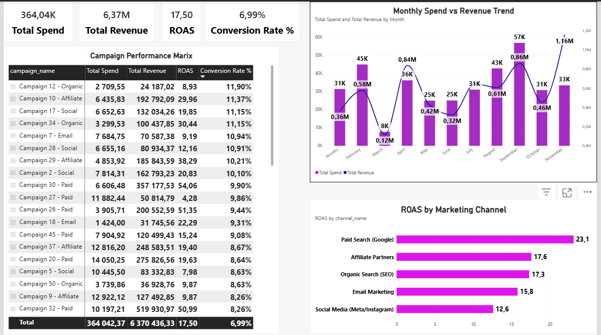
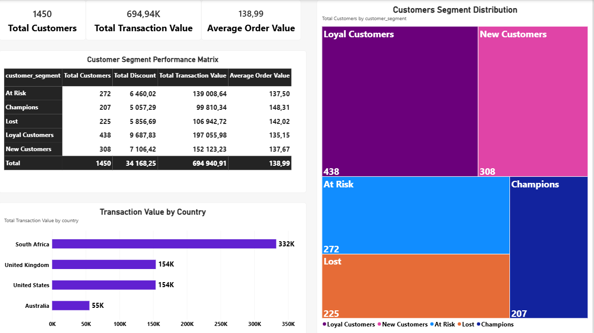
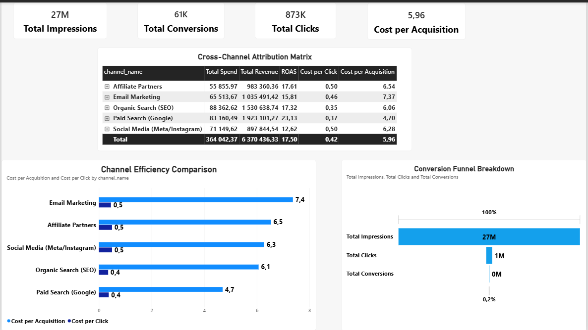

# 📈 Project 54: Marketing & Customer Analytics Solution

## 🚀 Executive Summary
Welcome to **Project 54**, an enterprise-grade analytics suite designed for digital marketing agencies, e-commerce brands, and growth marketers. This project provides comprehensive visibility into multi-channel campaign performance, return on ad spend (ROAS), customer segmentation (CLV & RFM focus), and conversion funnel bottlenecks.

---

## 🏗️ Architecture & Data Pipeline
Built on a scalable relational **Star Schema** generated via Python and modeled in Power BI:

* **Fact Tables:** 
  * `Fact_Campaigns`: Tracks digital ad campaigns, channel allocations, ad spend, impressions, clicks, conversions, and revenue generated.
  * `Fact_Transactions`: Tracks customer orders, order values, and discounts applied across various acquisition touchpoints.
* **Dimension Tables:** 
  * `Dim_Channels`: Marketing channels (*Paid Search, Social Media, Email Marketing, Organic Search, Affiliate Partners*).
  * `Dim_Customers`: Customer demographics, registration dates, regional location, and behavioral segments (*Champions, Loyal, At Risk, Lost, New*).

  ---

## 📊 Dashboard Preview & Page Breakdown

### 1️⃣ Campaign Performance & Marketing ROI (`CP&MROI`)
Evaluates advertising expenditure efficiency and overall revenue generation.
* **Key Metrics:** Total Spend, Total Revenue, ROAS (Return on Ad Spend), and Conversion Rate %.
* **Visual Highlights:** Monthly spend vs. revenue trends, ROAS benchmarking by channel, and granular campaign performance matrices.



---

### 2️⃣ Customer Segmentation & Lifetime Value (`CS&LV`)
Monitors customer behavior tiers, transaction sizes, and regional value contribution.
* **Key Metrics:** Total Customers, Total Transaction Value, and Average Order Value (AOV).
* **Visual Highlights:** Customer segment tier distribution, geographic revenue breakdowns, and segment financial matrices.



---

### 3️⃣ Conversion Funnel & Cross-Channel Attribution (`CF&CCA`)
Analyzes top-of-funnel conversion drops and cross-channel efficiency metrics.
* **Key Metrics:** Total Impressions, Total Clicks, Total Conversions, and Cost per Acquisition (CPA).
* **Visual Highlights:** Conversion funnel steps, cost-per-click (CPC) by channel, and multi-channel attribution tables.



---

## ⚙️ Key DAX Measures Implemented
```dax
-- Return on Ad Spend (ROAS)
ROAS = 
DIVIDE(
    SUM(Fact_Campaigns[revenue_generated]),
    SUM(Fact_Campaigns[spend]),
    0
)

-- Cost per Acquisition (CPA)
Cost per Acquisition = 
DIVIDE(
    SUM(Fact_Campaigns[spend]),
    SUM(Fact_Campaigns[conversions]),
    0
)
```

💡 Conclusion & Business Impact

Project 54 showcases high-level proficiency in marketing analytics and customer attribution modeling. By transforming raw campaign logs and customer touchpoints into an interactive Power BI executive dashboard, marketing leaders can dynamically reallocate budgets to high-ROAS channels and optimize customer retention loops.